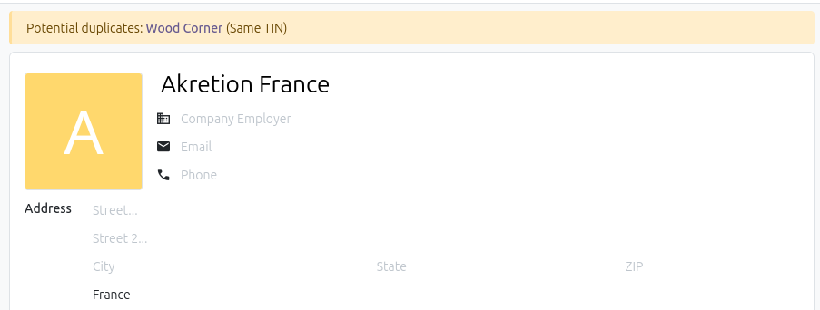

.. image:: https://odoo-community.org/readme-banner-image
   :target: https://odoo-community.org/get-involved?utm_source=readme
   :alt: Odoo Community Association

============================
Improved SIRET/SIREN support
============================

.. 
   !!!!!!!!!!!!!!!!!!!!!!!!!!!!!!!!!!!!!!!!!!!!!!!!!!!!
   !! This file is generated by oca-gen-addon-readme !!
   !! changes will be overwritten.                   !!
   !!!!!!!!!!!!!!!!!!!!!!!!!!!!!!!!!!!!!!!!!!!!!!!!!!!!
   !! source digest: sha256:c39c8cee56c1165d04d9c418e5cbe5b00010ab03e30ce90902d4b63704bc438d
   !!!!!!!!!!!!!!!!!!!!!!!!!!!!!!!!!!!!!!!!!!!!!!!!!!!!

.. |badge1| image:: https://img.shields.io/badge/maturity-Mature-brightgreen.png
    :target: https://odoo-community.org/page/development-status
    :alt: Mature
.. |badge2| image:: https://img.shields.io/badge/license-AGPL--3-blue.png
    :target: http://www.gnu.org/licenses/agpl-3.0-standalone.html
    :alt: License: AGPL-3
.. |badge3| image:: https://img.shields.io/badge/github-OCA%2Fl10n--france-lightgray.png?logo=github
    :target: https://github.com/OCA/l10n-france/tree/20.0/l10n_fr_siret
    :alt: OCA/l10n-france
.. |badge4| image:: https://img.shields.io/badge/weblate-Translate%20me-F47D42.png
    :target: https://translation.odoo-community.org/projects/l10n-france-20-0/l10n-france-20-0-l10n_fr_siret
    :alt: Translate me on Weblate
.. |badge5| image:: https://img.shields.io/badge/runboat-Try%20me-875A7B.png
    :target: https://runboat.odoo-community.org/builds?repo=OCA/l10n-france&target_branch=20.0
    :alt: Try me on Runboat

|badge1| |badge2| |badge3| |badge4| |badge5|

Since v20.0 of Odoo Community, the ``base`` module from the official
addons already handles the SIREN and SIRET. If you only need to stores
SIREN and SIRET, you do not need anymore ``l10n_fr_siret``.

What the native official addons handle (new in v20.0):

- the validity of the VAT, SIREN and SIRET independently with each other
  by verifying their checksum,
- updating the SIREN from the SIRET (only when the SIREN is empty).

What **l10n_fr_siret** brings for French partners:

- it checks the consistence between the VAT number and SIREN,
- it checks the consistence between the SIREN and SIRET,
- it detects duplicates between partner having the same SIREN and adds a
  warning banner on the partner form view to warn it. This is similar
  than native VAT duplicate warning. Actually, the SIREN warning will be
  hidden if the VAT warning is already displaid.

Note: ``l10n_fr_siret`` now depends of ``l10n_fr_account``. Indeed, the
widget ``x2many_buttons`` we used to list duplicates partners is
declared on ``account``.

|image|

**Table of contents**

.. contents::
   :local:

Usage
=====

The last digits of the SIREN and NIC are control keys: Odoo will already
check their validity.

The warning banner is displayed on the partner form view if another
partner:

- has the same SIREN,
- has not already the same VAT,
- if the partner is attached to a specific company: is in the same
  company or is not attached to a specific company,
- if the partner is not attached to a specific company: is in any
  company or not attached to a specific company.

Bug Tracker
===========

Bugs are tracked on `GitHub Issues <https://github.com/OCA/l10n-france/issues>`_.
In case of trouble, please check there if your issue has already been reported.
If you spotted it first, help us to smash it by providing a detailed and welcomed
`feedback <https://github.com/OCA/l10n-france/issues/new?body=module:%20l10n_fr_siret%0Aversion:%2020.0%0A%0A**Steps%20to%20reproduce**%0A-%20...%0A%0A**Current%20behavior**%0A%0A**Expected%20behavior**>`_.

Do not contact contributors directly about support or help with technical issues.

Credits
=======

Authors
-------

* Numérigraphe
* Akretion

Contributors
------------

- Lionel Sausin (Numérigraphe) <ls@numerigraphe.com>
- Alexis de Lattre <alexis.delattre@akretion.com>

Maintainers
-----------

This module is maintained by the OCA.

.. image:: https://odoo-community.org/logo.png
   :alt: Odoo Community Association
   :target: https://odoo-community.org

OCA, or the Odoo Community Association, is a nonprofit organization whose
mission is to support the collaborative development of Odoo features and
promote its widespread use.

.. |maintainer-alexis-via| image:: https://github.com/alexis-via.png?size=40px
    :target: https://github.com/alexis-via
    :alt: alexis-via

Current `maintainer <https://odoo-community.org/page/maintainer-role>`__:

|maintainer-alexis-via| 

This module is part of the `OCA/l10n-france <https://github.com/OCA/l10n-france/tree/20.0/l10n_fr_siret>`_ project on GitHub.

You are welcome to contribute. To learn how please visit https://odoo-community.org/page/Contribute.
