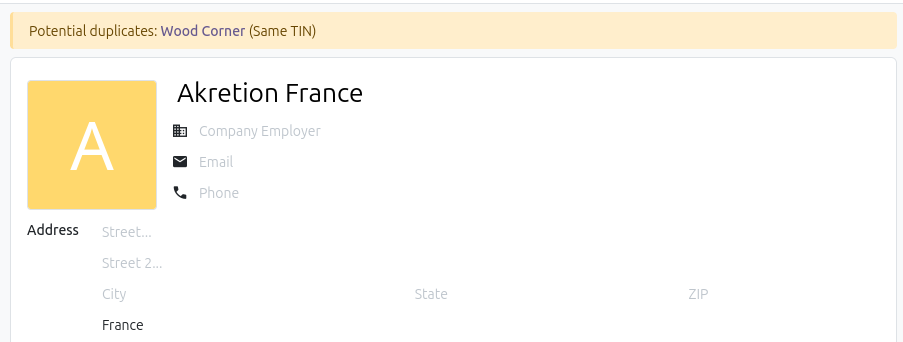

Since v20.0 of Odoo Community, the `base` module from the official addons
already handles the SIREN and SIRET. If you only need to stores SIREN and
SIRET, you do not need anymore `l10n_fr_siret`.

What the native official addons handle (new in v20.0):
- the validity of the VAT, SIREN and SIRET independently with each other
  by verifying their checksum,
- updating the SIREN from the SIRET (only when the SIREN is empty).

What **l10n_fr_siret** brings for French partners:
- it checks the consistence between the VAT number and SIREN,
- it checks the consistence between the SIREN and SIRET,
- it detects duplicates between partner having the same SIREN and adds a
  warning banner on the partner form view to warn it. This is similar than
  native VAT duplicate warning. Actually, the SIREN warning will be hidden
  if the VAT warning is already displaid.

Note: `l10n_fr_siret` now depends of `l10n_fr_account`. Indeed, the widget
`x2many_buttons` we used to list duplicates partners is declared on `account`.

